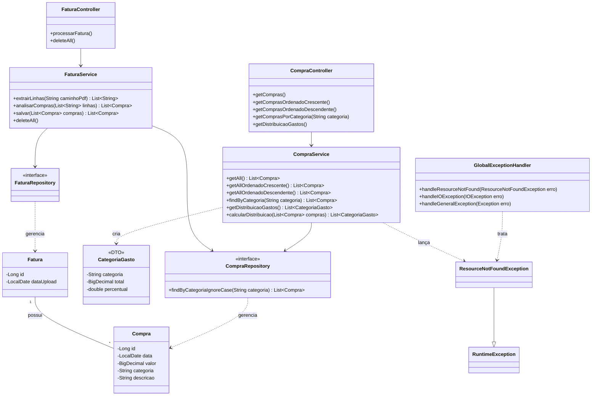
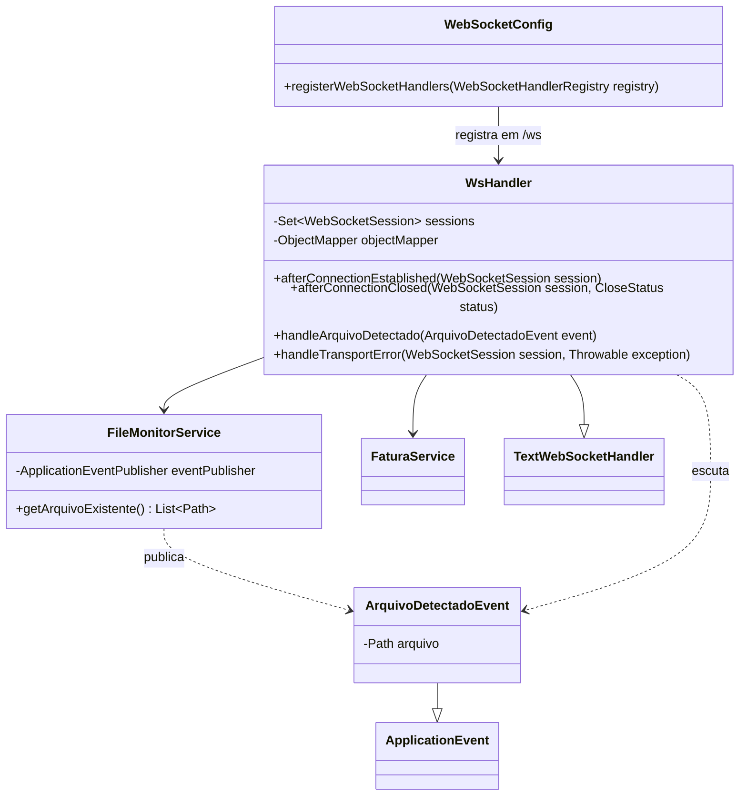
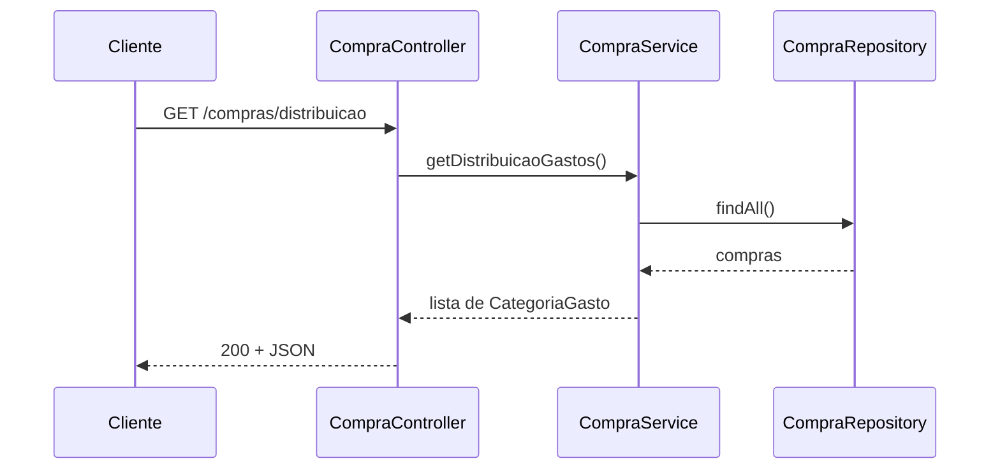
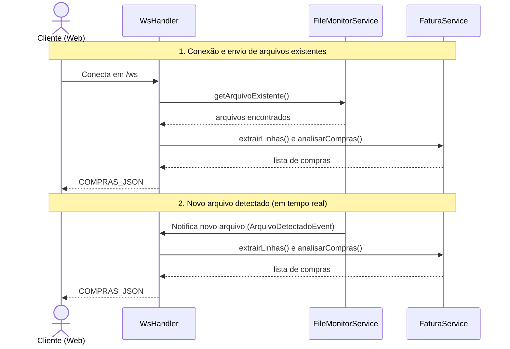

# Fatura

Sistema backend para análise, processamento e organização de faturas de cartão de crédito desenvolvido para aplicações web com o objetivo de melhorar a organização financeira. Conta com monitoramento em tempo real via WebSocket e interface para acompanhamento ao vivo.

## Público alvo

Pessoas que procuram organizar os gastos que tem na fatura de uma forma a investir ou economizar dinheiro.
Além de visualizar de forma personalizavel.

## Requisitos funcionais

* Deve ser possível ordenar os valores; Ex: Usuário escolhe critério de ordenação (crescente/decrescente) → sistema reordena a lista pelo valor.
* Deve ter filtros de pesquisa para agrupar as compras por categoria ou descrição; Ex: Usuário seleciona uma categoria ou descrição → sistema exibe apenas os lançamentos correspondentes.
* Upload e monitoramento de arquivos de fatura em formato PDF; Ex: Usuário adiciona arquivo no diretório `fatura/` → sistema detecta automaticamente.
* Validação do tipo e formato do arquivo; Ex: Sistema verifica se a extensão é .pdf e se o tamanho está dentro do limite → aprova o arquivo para processamento.
* Processamento automático da fatura após upload ou detecção; Ex: Sistema lê o PDF, extrai data, descrição, valor e parcela de cada lançamento, e os disponibiliza para listagem.
* Notificação em tempo real via WebSocket; Ex: Ao detectar ou processar faturas, envia os lançamentos em JSON para os clientes conectados.
* Visualização web ao vivo; Ex: Página estática (`index.html`) conectada ao WebSocket exibe eventos e faturas processadas.

## Requisitos não funcionais

* Desempenho: Processar faturas de até um tamanho específico (a definir).
* Confiabilidade: Falha na extração da fatura não compromete o resto da aplicação.
* Compatibilidade: suporte para fatura do banco Itaú.

## Modelagem

O sistema conta com backend Spring Boot, monitoramento contínuo da pasta `fatura/` via Java NIO (`WatchService`) e interface estática para visualização.
Os gastos processados são disponibilizados via REST e via eventos WebSocket.

## Stacks

* Spring framework;
* Java 25;
* H2;

## Autoria

A interface de monitoramento e lógica de websocket foi pega da atividade de bate-papo apresentada pelo professor e ajustada para o nosso uso.

## Casos de uso

### Consultar distribuição de gastos por categoria

- **Ator:** usuário
- **Pré-condição:** fatura/extrato já processado (`POST /faturas`)
- **Fluxo principal:**
  1. O usuário solicita a distribuição de gastos
  2. O sistema soma os gastos (compras de valor negativo) de cada categoria
  3. O sistema devolve cada categoria com o total e o percentual sobre o total de gastos, da maior para a menor
- **Fluxo alternativo:** se não houver nenhum gasto (banco vazio ou só entradas), o sistema responde `404`

### Monitoramento e processamento em tempo real via WebSocket

- **Ator:** Usuário / Cliente Web (Navegador)
- **Pré-condição:** Aplicação em execução, diretório `fatura/` criado
- **Fluxo principal:**
  1. O cliente conecta no endpoint `ws://localhost:8080/ws` (ou acessa `index.html`)
  2. O servidor registra a sessão e busca arquivos já existentes na pasta `fatura/`
  3. Existindo arquivos, o sistema extrai e envia os lançamentos no formato `COMPRAS_JSON:<dados>`
  4. Ao adicionar um novo arquivo PDF em `fatura/`, o `FileMonitorService` detecta a criação (`ENTRY_CREATE`), aguarda a escrita completa e dispara `ArquivoDetectadoEvent`
  5. `WsHandler` escuta o evento, processa as compras via `FaturaService` e transmite a mensagem `COMPRAS_JSON:<dados>` para todas as sessões abertas
  6. A interface `index.html` renderiza o extrato em tempo real na tela
- **Fluxos alternativos:**
  - Se a pasta estiver vazia ao conectar, o servidor informa que está aguardando novos arquivos
  - Em caso de falha de leitura ou processamento, o servidor envia mensagem `ERRO: <mensagem>` aos clientes
  - Em caso de erro de transporte, `handleTransportError` registra a falha e notifica a sessão

## Uso de IA

[USO-IA.md](USO-IA.md)

## Manual

### Arquitetura

Camadas: Controller / Handler → Service → Repository → Banco (H2), com tratamento global de exceções e eventos assíncronos.

* FaturaController: recebe as requisições REST de processamento e exclusão da fatura.
* FaturaService: extrai o texto do PDF (PDFBox), interpreta os lançamentos por regex,
  classifica cada um por categoria e salva.
* CompraController: expõe as consultas sobre as compras já salvas.
* CompraService: consulta, filtra e ordena via CompraRepository; lança
  ResourceNotFoundException quando a consulta não encontra nada.
* FileMonitorService: monitora a pasta `fatura/` em background usando Java NIO `WatchService`, aguarda a escrita terminar e dispara `ArquivoDetectadoEvent`.
* WsHandler: gerencia conexões WebSocket em `/ws`, processa arquivos existentes na conexão, intercepta eventos de arquivos detectados, realiza tratamento de erro de transporte e envia faturas em tempo real (`COMPRAS_JSON`).
* WebSocketConfig: registra o endpoint `/ws` e configura handlers WebSocket.
* GlobalExceptionHandler: intercepta as exceções lançadas pelos services/controllers e converte em
  respostas HTTP padronizadas.
* Interface Web (`static/index.html`): cliente visual que conecta ao WebSocket e exibe logs e faturas processadas ao vivo.

#### Diagramas de classes

##### 1. Domínio e REST

##### 2. WebSocket e monitoramento de pasta

#### Diagramas de sequência:

##### 1. Distribuição de gastos (REST):

##### 2. Monitoramento e processamento em tempo real (WebSocket):

### Modelo de dados

`Fatura` (1) <— (N) `Compra`

**Fatura**

Colunas: id e dataUpload

**Compra**

Colunas: id, data, descricao, valor, categoria e fatura

Cada requisição (POST /faturas) cria uma nova Fatura e associa a ela todas as compras
extraídas naquela requisição.

### API e Comunicação

| Tipo | Endpoint | Parâmetros | Sucesso | Erro |
|---|---|---|---|---|
| POST | /faturas | — | `200` + lista de Compra criadas | — |
| DELETE | /faturas/deleta | — | `204` sem corpo | — |
| GET | /compras | — | `200` + lista de Compra | `404` "Nenhuma compra encontrada" |
| GET | /compras/ordenado/crescente | — | `200` + lista ordenada por valor (asc) | `404` idem |
| GET | /compras/ordenado/decrescente | — | `200` + lista ordenada por valor (desc) | `404` idem |
| GET | /compras/categoria/{categoria} | categoria | `200` + lista filtrada | `404` "Nenhuma compra encontrada para a categoria: {categoria}" |
| GET | /compras/distribuicao | — | `200` + lista de `{categoria, total, percentual}` | `404` "Nenhum gasto encontrado" |
| WebSocket | /ws | — | Conexão estabelecida e streaming de mensagens (`COMPRAS_JSON:`) | — |
| Web UI | /index.html | — | `200` página de monitoramento ao vivo | — |

### Documentação da API (OpenAPI)

- Swagger UI (com a aplicação rodando): http://localhost:8080/swagger-ui/index.html
- Especificação: [docs/openapi.yaml](docs/openapi.yaml)

#### Manual de implantação e utilização: [manual-implantacao-utilizacao.md](manual-implantacao-utilizacao.md)