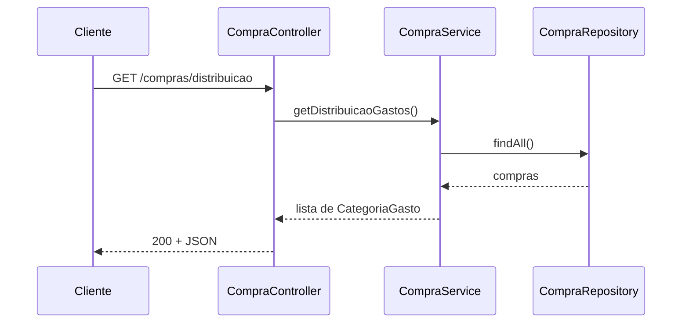

# Fatura

Sistema backend para análise, processamento e organização de faturas de cartão de crédito desenvolvido aplicações web com o objetivo de melhorar a organização financeira

## Público alvo

Pessoas que procuram organizar os gastos que tem na fatura de uma forma a investir ou economizar dinheiro.
Além de visualizar de forma personalizavel.

## Requisitos funcionais

* Deve ser possível ordenar os valores; Ex: Usuário escolhe critério de ordenação (crescente/decrescente) → sistema reordena a lista pelo valor.
* Deve ter filtros de pesquisa para agrupar as compras por categoria ou descrição; Ex: Usuário seleciona uma categoria ou descrição → sistema exibe apenas os lançamentos correspondentes.
* Upload de arquivos de fatura em formato PDF; Ex: Usuário seleciona um arquivo PDF → sistema recebe o arquivo.
* Validação do tipo e formato do arquivo; Ex: Sistema verifica se a extensão é .pdf e se o tamanho está dentro do limite → aprova o arquivo para processamento.
* Processamento automático da fatura após o upload; Ex: Sistema lê o PDF, extrai data, descrição, valor e parcela de cada lançamento, e os disponibiliza para listagem.

## Requisitos não funcionais

* Desempenho: Processar faturas de até um tamanho específico (a definir).
* Confiabilidade: Falha na extração da fatura não compromete o resto da aplicação.
* Compatibilidade: suporte para fatura do banco Itaú).

## Modelagem

O sistema sera somente o back-end e o arquivo de fatura deve estar em fatura/fatura.pdf.
Os gastos processados deverão ser disponibilizados de forma estruturada.

## Stacks

* Spring framework;
* Java 25;
* H2;

## Casos de uso

### Consultar distribuição de gastos por categoria

- **Ator:** usuário
- **Pré-condição:** fatura/extrato já processado (`POST /faturas`)
- **Fluxo principal:**
  1. O usuário solicita a distribuição de gastos
  2. O sistema soma os gastos (compras de valor negativo) de cada categoria
  3. O sistema devolve cada categoria com o total e o percentual sobre o total de gastos, da maior para a menor
- **Fluxo alternativo:** se não houver nenhum gasto (banco vazio ou só entradas), o sistema responde `404`

## Uso de IA

[USO-IA.md](USO-IA.md)

## Manual

### Arquitetura

Camadas: Controller → Service → Repository → Banco (H2), com tratamento de exceções.

* FaturaController: recebe as requisições de processamento e exclusão da fatura.
* FaturaService: extrai o texto do PDF (PDFBox), interpreta os lançamentos por regex,
  classifica cada um por categoria e salva.
* CompraController: expõe as consultas sobre as compras já salvas.
* CompraService: consulta, filtra e ordena via CompraRepository; lança
  ResourceNotFoundException quando a consulta não encontra nada.
* GlobalExceptionHandler: intercepta as exceções lançadas pelos services e converte em
  respostas HTTP padronizadas.

#### Diagrama de sequência:

### Modelo de dados

`Fatura` (1) <— (N) `Compra`

**Fatura**

Colunas: id e dataUpload

**Compra**

Colunas: id, data, descricao, valor, categoria e fatura

Cada requisição (POST /faturas) cria uma nova Fatura e associa a ela todas as compras
extraídas naquela requisição.

### API

| Requisição | Endpoint                      | Parâmetros | Sucesso | Erro |
|------------|-------------------------------|---|---|---|
| POST       | /faturas                      | — | `200` + lista de Compra criadas | — |
| DELETE     | /faturas/deleta               | — | `204` sem corpo | — |
| GET        | /compras                      | — | `200` + lista de Compra | `404` "Nenhuma compra encontrada" |
| GET        | /compras/ordenado/crescente   | — | `200` + lista ordenada por valor (asc) | `404` idem |
| GET        | /compras/ordenado/decrescente | — | `200` + lista ordenada por valor (desc) | `404` idem |
| GET        | /compras/categoria/{categoria} | categoria  | `200` + lista filtrada | `404` "Nenhuma compra encontrada para a categoria: {categoria}" |
| GET | /compras/distribuicao | — | `200` + lista de `{categoria, total, percentual}` | `404` "Nenhum gasto encontrado" |

#### Manual de implantação e utilização: [manual-implantacao-utilizacao.md](manual-implantacao-utilizacao.md)